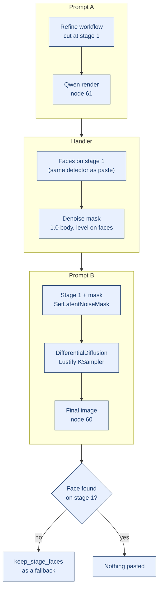

# Two-stage NSFW refine pipeline (Qwen-2511 → Lustify)

Optional second stage that runs **after** Qwen-Image-Edit-2511 stages the scene: re-encodes Qwen's output into an SDXL latent and refines it img2img with a **Lustify V5** (SDXL NSFW) pass at **denoise 0.55** — pushing explicit detail where Qwen is weak, while preserving pose / scene / framing.

Validated sweet spot (POC): denoise **0.50–0.60**. <0.40 leaves clothing/watermark residue; >0.70 breaks composition.

## Activation (request)

Add `refine: true` (alias `nsfw_refine`) to the job input. Stage 1 still receives `prompt` / `image_url` / `seed` / `lora_url` as usual (they target the Qwen stage).

```json
{
  "input": {
    "prompt": "full body shot, same person, same pose, same background",
    "image_url": "https://.../source.jpg",
    "refine": true,
    "refine_prompt": "nude, fully naked, photorealistic, natural skin texture, same pose",
    "refine_negative": "clothing, lingerie, cartoon, deformed, watermark",
    "refine_denoise": 0.55
  }
}
```

`refine_prompt` / `refine_negative` / `refine_denoise` are optional overrides of the stage-2 (node 203/204/205) defaults baked in `workflow/qwen2511_lustify_refine_1image.json`. Only the **1-image** variant exists today; multi-image falls back to the normal workflow.

## Required models on the endpoint

The combined workflow needs, in addition to the Qwen models already baked:
- `/ComfyUI/models/vae/sdxl_vae_fp16fix.safetensors` — public (madebyollin/sdxl-vae-fp16-fix). **Mandatory** (the SDXL embedded fp16 VAE NaNs → black images).
- `/ComfyUI/models/checkpoints/lustifySDXLNSFW_endgame.safetensors` — Lustify ENDGAME.

Both are baked by the Dockerfile from **public HF mirrors** — no Civitai token / age-gate:
- VAE: `madebyollin/sdxl-vae-fp16-fix`
- Lustify ENDGAME single-file: `xxxpo13/LUSTIFY_SDXL` → `lustifySDXLNSFW_endgame.safetensors`

`docker build .` (or a RunPod Hub rebuild on push) bakes everything; no build args needed. Alternatives in the same repo: `lustifySDXLNSFW_endgameDMD2.safetensors` (few-step, change node 205 to ~6 steps / cfg ~1.5), or `_v40` / `_v30`. APEX V8 / GGWP V7 are Civitai-only (model 573152, versions 2808677 / 2155386 — need a free token + age-verified account). The filename **must match** workflow node 200. For lighter images / faster cold-start, drop the two Dockerfile `wget` lines and mount the files via a RunPod network volume instead.

## Graph shape

`78 LoadImage → 93 scale(1MP) → [Qwen stage: 88/110/111/3/8] → 202 VAEEncode(SDXL VAE) → 205 KSampler(Lustify, dpmpp_2m_sde/karras, 28 steps, cfg 5.5, denoise 0.55) → 206 VAEDecode → 60 SaveImage (final)`.

Handler injection points (78 image, 111 prompt, 3 seed, 190 user-LoRA) are unchanged, so existing callers keep working; `refine` only swaps the workflow file.

## Masked refine (`refine_face_mode: "mask"`)

By default (`"paste"`) the Lustify pass denoises the whole frame, then `keep_stage_faces` glues the Qwen faces back through a feathered ellipse: the identity survives but the seam and the texture mismatch show. The opt-in `"mask"` mode makes the refine itself denoise the faces little, so Lustify keeps the Qwen identity and only harmonises the texture, with nothing to paste. It applies to the 1-image refine only; without `refine`, or with several images, the parameter is ignored. `"paste"` stays the default and behaves exactly as before.



The handler runs two ComfyUI prompts on the same connection. **Prompt A** is the refine workflow with the Lustify stage (nodes 200-206 and 60) removed, so its only output is the stage-1 image (node 61). The handler then detects the faces on that image with `_detect_faces(..., require_keypoints=False)` and builds a grayscale mask the size of the image, written as a PNG next to the input images. **Prompt B** (`workflow/lustify_refine_masked.json`) keeps nodes 200, 201, 203, 204, 205, 206 and 60 of the refine workflow (same checkpoint, VAE, texts and sampler settings; the `refine_prompt` / `refine_negative` / `refine_denoise` overrides apply the same way) and adds `LoadImage` (207, stage 1) -> `VAEEncode` (202), `LoadImageMask` (208, channel red) -> `SetLatentNoiseMask` (209), and `DifferentialDiffusion` (210) on the KSampler's model. Node 60 is still the final image. The seed override only targets the Qwen KSampler (node 3), as in the combined workflow: node 205 keeps its seed.

With Differential Diffusion, a pixel of mask value m is only denoised on the steps whose time threshold is <= m, so the effective denoise is about m x `refine_denoise`: the default level 0.35 gives ~0.19 on a face, 0.0 keeps the stage-1 latent untouched. ComfyUI at the pinned SHA keeps the loaders' outputs from one prompt to the next, so the split does not reload any model.

The mask is 1.0 over the body and, on each face, an ellipse with the geometry of `keep_stage_faces` (centre shifted by -0.05 x face height, semi-axes 0.62 x width and 0.78 x height) at `refine_face_level`, blurred by `refine_face_feather` x the face size. A face whose smaller side is under `refine_face_min_px` gets 0.0 (not denoised at all): at ~12 latent pixels a weak denoise only smears the eyes and the nose. Overlapping faces combine by minimum.

If no face was found on stage 1 (0.6 % of the renders measured), the mask is all 1.0 and `keep_stage_faces` runs as the fallback, as in paste mode (`refine_keep_face` keeps its meaning and can turn it off). If at least one face was masked, nothing is pasted.

### Parameters (all optional, validated)

| Key | Default | Range | Meaning |
| --- | --- | --- | --- |
| `refine_face_mode` | `"paste"` | `"paste"`, `"mask"` | Anything else falls back to `"paste"`. |
| `refine_face_level` | 0.35 | 0 to 1 | Mask value on a face, a fraction of `refine_denoise`. |
| `refine_face_feather` | 0.25 | 0.05 to 1 | Blur of the face ellipse, as a fraction of the face size. |
| `refine_face_min_px` | 96 | 0 to 512 | Faces smaller than this (smaller side, pixels) are not denoised. |

Numbers out of range are clamped, unreadable ones fall back to the default.

### Status (`refine_faces` in the output)

In mask mode: `{"mode": "mask", "masked": N, "small": n_small, "level": x, "feather": y, "min_px": z, "faces": [{"w": .., "h": .., "det": .., "sim_src": ..}], "fallback_paste": bool}`, plus a `"paste"` key holding the `keep_stage_faces` status when the fallback ran. `masked` counts every face written into the mask, the small ones included. `sim_src` is the ArcFace similarity of that stage-1 face to the best matching face of the job's source image (`null` when the source has none or when the stage-1 keypoints are degenerate, an embedding that would read ~0 without meaning a lost identity): a measurement only, it changes nothing. In paste mode the existing `keep_stage_faces` status gains `"mode": "paste"`. The `mode` key exists only in this version: it is the positive proof of version on a pod.

### Validation

Unit tests: `tests/test_face_denoise_mask.py` (mask), `tests/test_refine_mask_graph.py` (prompt A pruning, prompt B wiring, parameters) and `tests/test_handler_masked_refine.py` (the handler end to end with a fake ComfyUI), run with `python -m pytest tests -q` inside a container (needs `opencv-python-headless`). ComfyUI acceptance of both graphs, at the pinned SHA and without a GPU, is checked by `tools/comfy-probe/` (empty model files at the right names, `main.py --cpu`, the body of any 400 printed): see the header of `tools/comfy-probe/Dockerfile.validate`.

## Bench candidates (next)

Swap node 200's checkpoint to A/B the refiner: Lustify V5 vs Pony V6 XL (POC baseline) vs Juggernaut XL. Stage-1 NSFW Qwen LoRA (QIE-SRD / META4) can be stacked via `lora_url`.
